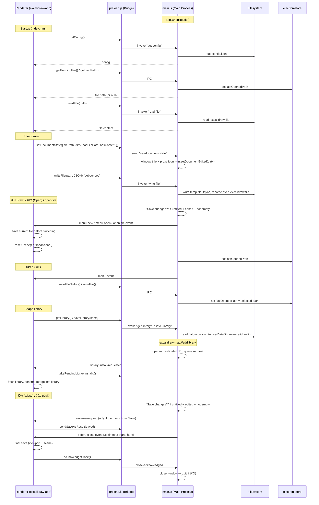

# Excalidraw Mac

A desktop application for [Excalidraw](https://excalidraw.com/), which auto-saves your drawings to local files.

## Getting Started

Requires Node.js 24.15 or newer (see `.nvmrc`). Node 24 matches the Node bundled in Electron 45, so CI tests the main-process code on the same major version the app runs on. When upgrading Electron to a release with a newer bundled Node, bump `.nvmrc` and `engines` in `package.json` together.

1. Install dependencies.
2. Set your preferences in `config.json` (window size, auto-save timing, default open directory).
3. Build and package the app.

```bash
npm install
npm run compile   # lint -> test -> format -> build -> package DMG
```

4. Open the DMG in `dist/` and drag **excalidraw-mac** into Applications. Spotlight lists apps from there; search for `excalidraw-mac`.

### Future maintenance - Upgrading Excalidraw

If you upgrade `@excalidraw/excalidraw`, refresh the bundled font assets so the app uses matching fonts.

```bash
npm install @excalidraw/excalidraw@latest
rm -rf excalidraw-app/public/fonts
cp -r node_modules/@excalidraw/excalidraw/dist/prod/fonts excalidraw-app/public/
npm ls @excalidraw/excalidraw
npm run build
```

Then launch with:

```bash
npm start
```

## Architecture



### Module Layout

| Path                                         | Process  | Role                                                                                                     |
| -------------------------------------------- | -------- | -------------------------------------------------------------------------------------------------------- |
| `main.js`                                    | main     | Wiring only: IPC handlers, windows, menu, OS `open-file`                                                 |
| `electron/fileService.js`                    | main     | Path validation, config reading, reading and writing `.excalidraw` files                                 |
| `electron/atomicWrite.js`                    | main     | Atomic file write (temp file, fsync, rename) used for every drawing write                                |
| `electron/menu.js`                           | main     | Builds the application menu template (Electron calls are passed in)                                      |
| `electron/document.js`                       | main     | Window title + proxy icon, "file became current" (lastOpenedPath + Open Recent), OS `open-file` handling |
| `electron/theme.js`                          | main     | Appearance preference, effective theme, `nativeTheme.themeSource`, Appearance menu                       |
| `electron/unsavedChanges.js`                 | main     | "Save changes?" prompt: when to ask, and what each answer means (pure, see #4)                           |
| `electron/windowSession.js`                  | main     | Per-window document state, unsaved-changes guard and close handshake                                     |
| `electron/navigationGuard.js`                | main     | Opens links in the system browser and keeps the window on the app (see #5)                               |
| `electron/libraryStore.js`                   | main     | Reads and writes the shape library at a fixed path in the app's data folder                              |
| `electron/libraryIpc.js`                     | main     | IPC for loading and saving the shape library                                                             |
| `electron/libraryInstall.js`                 | main     | `excalidraw-mac://` install links: registration, queueing, delivery to the renderer                      |
| `shared/libraryUrl.mjs`                      | both     | Library URL allowlist and install-link parsing, shared by main and the renderer                          |
| `preload.js`                                 | preload  | Exposes `window.electronAPI`; self-contained since sandboxed preload can't `require` local files         |
| `excalidraw-app/src/App.jsx`                 | renderer | Mounts Excalidraw and wires the hooks                                                                    |
| `excalidraw-app/src/hooks/`                  | renderer | `useFileOperations`, `useAutoSave` (also reports document state), `useTheme` and `useLibrary`            |
| `excalidraw-app/src/utils/saveController.js` | renderer | Current file, dirty state, debounced + coalesced saves; every renderer write goes through it             |
| `excalidraw-app/src/utils/themeUtils.js`     | renderer | Tells Excalidraw's in-app theme toggle apart from prop-driven theme changes                              |
| `excalidraw-app/src/utils/sceneUtils.js`     | renderer | Parse, load and serialize scenes (including the viewport, see #3 below)                                  |

## Design Considerations

### #1 Why CommonJS?

Electron's sandboxed preload scripts [don't support ESM](https://www.electronjs.org/docs/latest/tutorial/esm#sandboxed-preload-scripts-cant-use-esm-imports), so `preload.js`, `main.js` and the main-process modules in `electron/` must use `require()`. This is why `package.json` sets `"type": "commonjs"`. The renderer files under `excalidraw-app/src/` still use ESM `import`/`export` — Vite handles those, not Node.js.

[`electron-store`](https://github.com/sindresorhus/electron-store) v12 is ESM-only and requires Node.js 22 or newer (and Electron 30 or newer). Electron 45 bundles Node.js 24, so `main.js` loads it with `require()` and takes the default export. That stays on the CommonJS loader, which still resolves inside a packaged asar. Dynamic `import()` is not used for this module, because that loader does not resolve packages inside asar archives.

`shared/libraryUrl.mjs` is the one exception to CommonJS: the main process and the renderer both need the same library URL allowlist, so it's plain ESM with no imports. `main.js` loads it with `require()` the same way it loads `electron-store`, and Vite bundles it into the renderer.

### #2 Why does the main process write files instead of fileHandle.createWritable()?

- `fileHandle.createWritable()` is a browser [File System Access API](https://developer.mozilla.org/en-US/docs/Web/API/FileSystemWritableFileStream) — it runs in the renderer, which is sandboxed and shouldn't own filesystem operations
- `FileSystemFileHandle` objects can't be sent across the IPC boundary (not serializable)
- File I/O runs in the **main process** (privileged, in `electron/fileService.js`), following Electron's security model: renderer requests → main process executes
- Reads and writes use `fs.promises`, so saving a large drawing (embedded images) doesn't block the main process
- Every drawing write (auto-save, ⌘S, Save As, before switching, before close) is **atomic** (`electron/atomicWrite.js`): the content goes to a hidden temp file in the same folder (`.<name>.<random>.tmp`), is fsynced, then renamed over the target. A crash or full disk mid-save leaves the previous file intact, and the temp file is removed on failure. Symlinked files are written through to their target, and the existing file's permissions are kept.
- Content is serialized via Excalidraw's `serializeAsJSON()` which outputs the standard `.excalidraw` JSON format

### #3 Why is viewport state (scroll/zoom) re-injected after serialization?

Excalidraw's `serializeAsJSON()` uses an internal config (`APP_STATE_STORAGE_CONF`) that marks `scrollX`, `scrollY`, and `zoom` as `export: false` — they're intentionally stripped for portable `.excalidraw` files. Since this is a desktop app that should resume exactly where you left off, `serializeScene()` re-injects these fields after serialization. It splices them into the `"appState"` object of `serializeAsJSON()`'s output string rather than parsing and re-stringifying the whole file, which matters when drawings embed large base64 images. The file stays standard `.excalidraw` JSON (2-space indented) that excalidraw.com can open. On load, `parseInitialData()` checks if viewport fields exist: if present, the saved position is restored; if absent (e.g., a file from excalidraw.com), it falls back to `scrollToContent`.

A final save is triggered on window close (⌘W) and app quit (⌘Q) via a `before-close` → `close-acknowledged` IPC handshake, ensuring the latest viewport is always persisted. File switches (⌘N, ⌘O) also save the current file before loading the new one. Scrolling and zooming alone don't trigger an auto-save; the viewport is written with the next save.

### #4 Unsaved changes and closing

The renderer tracks whether the drawing has edits since it was last loaded or saved (`dirty`) and reports `{ dirty, hasFilePath, hasContent }` to the main process. The main process uses it to:

- show the macOS "edited" dot in the close button. For a drawing with a file, the dot clears once the auto-save completes.
- ask **"Do you want to save the changes you made to this drawing?"** (Save / Don't Save / Cancel) before closing the window, quitting, ⌘N, ⌘O, or opening a file from Finder — but only for an **untitled** drawing that is **not empty** and has **unsaved edits**. Drawings with a file are auto-saved, so they are never prompted. Save opens the Save As dialog; cancelling that dialog cancels the close or switch.

The prompt runs in the main process **before** `before-close` is sent, so the 3-second safety timeout (which force-closes if the renderer never acknowledges) only covers the renderer's final write, never the user deciding or picking a file name. Each window has its own session (`electron/windowSession.js`), so a window recreated after ⌘W doesn't inherit listeners or state from the old one.

Opening a file also clears Excalidraw's undo history, so ⌘Z can't bring back the previous drawing's elements into the newly opened file.

### #5 Links open in the system browser

The app window only ever shows its own `index.html`. Links in drawings, Excalidraw's "Browse libraries" button and any other `window.open` or navigation are handed to the default browser via `shell.openExternal` — but only for `http:`, `https:` and `mailto:` URLs. Everything else (`file:`, `javascript:`, `data:`, custom schemes) is blocked.

### Configuration (`config.json`)

| Option               | Type   | Default | Description                                       |
| -------------------- | ------ | ------- | ------------------------------------------------- |
| `windowWidth`        | number | 1512    | Window width in pixels                            |
| `windowHeight`       | number | 982     | Window height in pixels                           |
| `autoSaveDebounceMs` | number | 2000    | Debounce delay in milliseconds before auto-saving |
| `defaultOpenDir`     | string | (none)  | Default directory for file open/save dialogs      |

Window size is read when the app starts; the other options are read when they're used.

For the auto-save feature: The app automatically saves your drawing to the last opened file. Each edit restarts a debounce timer (`autoSaveDebounceMs`, default 2 seconds), and the drawing is saved once you pause, to avoid excessive disk writes. If a save is still being written when the next one is due, one more save of the latest drawing runs right after it, so no edit is skipped. A missing or invalid `autoSaveDebounceMs` falls back to 2000ms. The old `autoSaveCheckIntervalMs` option is no longer used and is ignored if present.

Opening a file or starting a new drawing doesn't trigger a save by itself; only edits do.

If no file is open (an untitled drawing), nothing is auto-saved. Use ⌘S to pick a file. If you try to close, quit, or switch drawings with unsaved edits, the app asks whether to save them first (see [#4](#4-unsaved-changes-and-closing)).

### Scripts

| Command                | Description                                       |
| ---------------------- | ------------------------------------------------- |
| `npm start`            | Launch the Electron app (requires a prior build)  |
| `npm run build`        | Build the renderer app for production             |
| `npm run dmg`          | Package the app into a DMG using electron-builder |
| `npm run compile`      | Lint → Test → Format → Build → Package DMG        |
| `npm run lint`         | Run ESLint                                        |
| `npm run format`       | Run Prettier                                      |
| `npm run format:check` | Check formatting without writing (used in CI)     |
| `npm test`             | Run the unit tests once                           |
| `npm run test:watch`   | Run the unit tests in watch mode                  |

### Testing

Unit tests use [Vitest](https://vitest.dev/) and sit next to the code they cover as `*.test.js`. `vitest.config.mjs` splits them into two projects:

- **main** (Node): `preload.test.js`, `electron/**/*.test.js` and `shared/**/*.test.js`. These load the CommonJS modules with `createRequire`. The preload test swaps a fake `electron` into Node's require cache, because `vi.mock` can't intercept a CommonJS `require`.
- **renderer** (jsdom): `excalidraw-app/src/**/*.test.{js,jsx}`. Hooks are tested with `@testing-library/react` and a mocked `window.electronAPI`. The real `@excalidraw/excalidraw` is used; `excalidraw-app/src/test/setup.js` stubs the canvas context it touches on import. `App.test.jsx` is the exception: it mocks the `Excalidraw` component to check the props `App` passes.

Tests never launch Electron or touch your real drawings or electron-store. File I/O tests write to a temp directory.

CI (`.github/workflows/ci.yml`) runs lint, format check, tests and the renderer build on every pull request and on pushes to `main`. Renovate only automerges once that check is green.

### Menu Shortcuts

| Shortcut / Menu           | Action                                         |
| ------------------------- | ---------------------------------------------- |
| ⌘N                        | New drawing                                    |
| ⌘O                        | Open file                                      |
| File → Open Recent        | Reopen a recent drawing (with **Clear Menu**)  |
| ⌘S                        | Save                                           |
| ⌘⇧S                       | Save As                                        |
| View → Appearance         | System / Light / Dark                          |
| ⇧⌥D (Excalidraw shortcut) | Toggle light / dark (sets the Appearance menu) |

The app also supports **file association** — double-clicking a `.excalidraw` file or using "Open With" will launch the app and load that file.

### Window title and proxy icon

The window title is the current file's name without its extension (`diagram.excalidraw` → "diagram"; only the last extension is dropped, so `a.b.excalidraw` → "a.b"), or "Untitled" when no file is open. On macOS the title also carries a proxy icon: drag it like the file, or ⌘-click the title for the folder path menu.

The renderer's save controller is the single source of truth: whenever the current file, dirty flag or content changes (startup load, ⌘N, ⌘O, Save As, Finder / Open Recent, edits) it sends one `set-document-state` report, and the main process updates the title, the represented filename and the edited dot from it. The renderer is the only side that knows a file actually loaded (a parse failure leaves the previous drawing in place), so the main process doesn't keep a second copy of this state. `index.html`'s `<title>` is ignored (`page-title-updated` is prevented).

### Open Recent

Every time a file becomes current through Open, Save As, Finder double-click / Open With, or Open Recent, the main process records it in one place: it saves `lastOpenedPath` and calls `app.addRecentDocument()`. macOS fills **File → Open Recent** (and the Dock menu's recent items) from that list. Choosing an item works whether a window is open (the file is handed to it, after saving the current drawing) or all windows are closed (a new window opens with that file).

If a recent file was moved or deleted, the app shows an error ("… can't be opened") and leaves the current drawing untouched. Electron has no API to remove a single entry from the list; **Clear Menu** empties it.

### Appearance (theme)

**View → Appearance** offers **System** (default), **Light** and **Dark**. The choice is stored in electron-store as `themePreference` and also sets `nativeTheme.themeSource`, so native menus and dialogs match. With **System**, the app follows macOS appearance changes live.

- Excalidraw's own theme toggle (main menu, or ⇧⌥D) stays visible. Using it sets the preference to that explicit theme (**Light** or **Dark**), and the Appearance menu updates to match. Choose **System** again to go back to following macOS.
- Files saved by this app don't contain a theme (Excalidraw leaves `appState.theme` out of `.excalidraw` files), but files from other tools or older Excalidraw versions can. That `appState.theme` is **ignored when loading**: opening a file never changes the app's theme.
- The window background matches the effective theme before the drawing loads, so there's no white flash on launch in dark mode.

### Shape Library

Your shape library (the "Library" sidebar) is saved automatically, separately from your drawings, so it's available in every drawing and survives restarts:

```
~/Library/Application Support/excalidraw-mac/library.excalidrawlib
```

It uses the standard `.excalidrawlib` format (`{ "type": "excalidrawlib", "version": 2, "libraryItems": [...] }`), so you can back it up or import it into excalidraw.com. Writes are atomic (temp file + rename). The renderer never chooses this path; it only sends library items over the `get-library` / `save-library` IPC channels.

If the file is unreadable as a library (invalid JSON or not an `.excalidrawlib`), the app starts with an empty library and copies the bad file to `library.excalidrawlib.bak`. The original is only replaced once you change the library.

#### Installing libraries from libraries.excalidraw.com

1. Open the Library sidebar and click **Browse libraries**. The site opens in your default browser.
2. Click **Add to Excalidraw** on a library. Your browser asks to open **excalidraw-mac**; allow it.
3. The app comes to the front and asks you to confirm adding the shapes. Confirmed libraries are merged into your existing library.

This works through the `excalidraw-mac://` URL scheme, which the packaged app registers with macOS (`build.protocols` in `package.json`). The site redirects to `excalidraw-mac://addlibrary#addLibrary=<library url>&token=<token>`. For safety, the app only downloads library URLs that are `https://libraries.excalidraw.com/...` (exact host, default port, no credentials). Anything else is rejected and logged. The app always asks before adding shapes, even when the request came from this app's own browse link.

`npm start` registers the scheme for the development Electron binary. macOS may keep routing `excalidraw-mac://` links to whichever copy of the app registered last, so after testing in dev, open the packaged app once to make it the handler again.

## Known Limitations

### Drag-and-drop + undo can lose images

If you drag and drop images onto the canvas and then undo, the embedded image data will be lost. To be safe, keep a backup of your `.excalidraw` file before drag-and-drop operations involving images.

## References

- [Excalidraw GitHub Repository](https://github.com/excalidraw/excalidraw)
- [Excalidraw Documentation](https://docs.excalidraw.com/)
- [Electron Documentation](https://www.electronjs.org/)
- [electron-builder](https://www.electron.build/)
- [electron-store](https://github.com/sindresorhus/electron-store)
